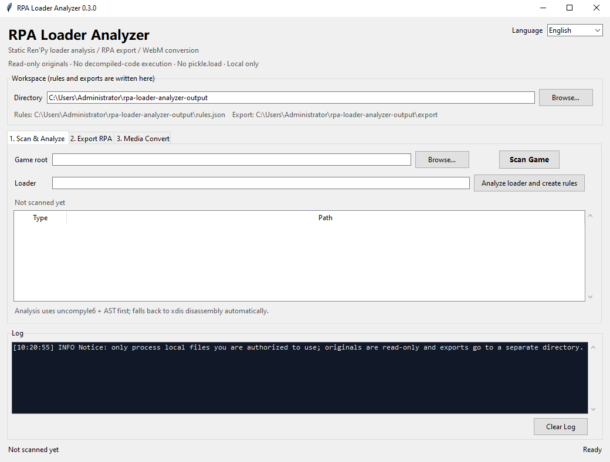

# rpa-loader-analyzer

本地、只读的 Ren'Py `loader.pyo` / RPA 资源包研究工具。

> **用途限制**：仅供对**拥有合法授权**的文件进行技术学习、兼容性研究和数据恢复。
> 不用于绕过访问控制、破解商业内容、规避反作弊或分发游戏资源。使用者需自行确认
> 当地法律、游戏许可协议和授权范围。详见 [docs/COMPLIANCE.md](docs/COMPLIANCE.md)。

## 项目定位

`rpa-loader-analyzer` 是一个命令行研究工具，解决三个问题：

1. 用 uncompyle6 将 `renpy/loader.pyo` 静态反编译为文本；
2. 用 Python AST 静态提取 XOR 解密常量，输出标准化规则 JSON；
3. 在**不使用 `pickle.load`** 的前提下安全解析 RPA 索引，应用 XOR 规则还原
   offset/size，将资源导出到独立目录。

它不会导入、执行或 `eval` 反编译得到的源码，也不会上传任何文件。

## 功能模块

| 模块 | 职责 |
| --- | --- |
| `src/scanner` | 递归定位 `renpy/loader.pyo`，收集全部 `*.rpa`，拒绝符号链接逃逸 |
| `src/decompiler` | 读取 `.pyo` magic，调用 uncompyle6；失败时用 xdis 静态反汇编 |
| `src/ast_analyzer` | AST 遍历 `BitXor`，常量/别名/简单表达式数据流追踪；反汇编文本的 XOR 回退分析 |
| `src/rpa_core` | RPA 头部、zlib 索引、安全 pickle 解析、XOR 规则应用 |
| `src/exporter` | 重建目录树、原子写入、过滤空文件、路径穿越防护 |
| `src/media_convert` | WebM 识别，优先流复制，失败后重编码；支持 NVENC/QSV/VAAPI |

## 安全设计（硬约束）

- **只读原始文件**：解析器只以 `rb` 打开 `.pyo`/`.rpa`；导出前校验输出目录不在游戏目录内。
- **不执行反编译源码**：没有 `exec`、`eval`、`importlib` 加载恢复代码。只做文本、
  `ast.parse` 分析和 xdis 反汇编。
- **反汇编也是静态的**：xdis 只读取 bytecode/code object 并生成指令文本，不导入、不执行。
  AST 失败时自动以反汇编作为低置信度回退。
- **禁止 `pickle.load`**：RPA 索引由 `pickletools.genops` 驱动自研白名单解释器解析，
  只允许基础类型；拒绝 `GLOBAL`/`REDUCE`/`BUILD`/`NEWOBJ` 等对象构造路径。
  仅对 Python 3 pickle 表示 bytes 的两个纯构造模式做结构化白名单处理：
  `_codecs.encode(str, encoding)` 和 `__builtin__ bytes`。
- **资源上限**：输入大小、解压后大小、字符串长度、容器元素数、嵌套深度、节点数均有上限，
  防止 zlib/pickle 炸弹。
- **路径穿越防护**：拒绝绝对路径、`..`、盘符、Windows ADS 冒号、保留设备名和链接目录。
- **原子导出**：先写同目录临时文件，成功后再替换；默认不覆盖已有文件。
- **本地处理**：无网络上传逻辑；FFmpeg 调用限制 `file` 协议。
- **外部进程最小化**：开发/测试期间只执行 Python 测试、目录创建等白名单操作；
  程序运行时只有用户显式执行 `convert` 才会以参数数组、`shell=False` 调用本地
  `ffmpeg`/`ffprobe`。未执行 `convert` 时不会启动 FFmpeg。

详细威胁模型见 [docs/SECURITY.md](docs/SECURITY.md)。

## 环境要求

- Python 3.10+
- Python 包：`uncompyle6`、`xdis`
- 可选：本地 `ffmpeg` 与 `ffprobe`（仅媒体转换需要，不随项目下载）

> uncompyle6 能处理的字节码版本由 `uncompyle6`/`xdis` 决定。Ren'Py 7 常见的
> Python 2.7 `loader.pyo` 是主要目标。若 uncompyle6 无法恢复源码，工具会调用
> xdis 生成反汇编并尝试低置信度 XOR 提取；不支持的目标版本会返回结构化错误。

## 安装

```bash
python -m venv .venv
# Windows
.venv\Scripts\activate
python -m pip install -r requirements.txt
```

## Windows GUI / EXE

已生成单文件 GUI：

```text
dist\RpaLoaderAnalyzer.exe
```


双击运行即可。界面包含三个简单页签：

1. **扫描与分析**：选择游戏目录，扫描 `renpy/loader.pyo` 和 RPA；一键分析并生成
   `工作目录\rules.json`。
2. **导出 RPA**：自动使用 `rules.json`（存在时），将全部归档导出到
   `工作目录\export\<归档名>\`。
3. **媒体转换**：选择 WebM 和输出 MP4，支持 NVENC/QSV/VAAPI 与强制 H.264/AAC
   重编码。

界面右上角可切换 **简体中文 / English**，仅支持这两种语言。切换后界面立即重建，
选择会保存到：

```text
%APPDATA%\rpa-loader-analyzer\settings.json
```

英文界面：



GUI 仍然遵守 CLI 的安全边界：只读原件、不执行反编译代码、不使用 `pickle.load`、
输出不在游戏目录内、FFmpeg 只在点击“开始转换”时调用。

重新构建 EXE：

```bash
python -m pip install -r requirements-build.txt
python -m PyInstaller --noconfirm --clean --onefile --windowed \
  --name RpaLoaderAnalyzer --paths . \
  --collect-all uncompyle6 --collect-all xdis \
  --distpath dist --workpath build --specpath build gui_entry.py
```

构建产物：

- `dist\RpaLoaderAnalyzer.exe`：窗口版单文件程序
- `build\`：PyInstaller 中间文件和警告报告

> 单文件 EXE 首次启动会解压运行时依赖，通常需要数秒。某些杀毒软件可能对
> PyInstaller 单文件程序误报；如遇到，可在受信任目录中从源码运行或改用 `--onedir` 构建。

## Git 仓库

项目已初始化为 `main` 分支的 Git 仓库，包含源码、测试、文档、截图和最终 EXE：

```bash
git status
git log --oneline
```

[.gitignore](.gitignore) 忽略 Python 缓存、虚拟环境、PyInstaller 中间目录
`build/`、运行时输出和临时文件，但通过例外规则保留：

```text
dist/RpaLoaderAnalyzer.exe
```

因此仓库可直接分发源码和最终 GUI 程序，同时避免提交构建中间产物。

## 快速开始

### 1. 扫描游戏目录

```bash
python -m src scan "D:\Games\MyGame"
```

输出 loader 路径、全部 RPA 和警告。可附加 `--json-out scan.json`。

### 2. 分析 loader

```bash
# 反编译 .pyo 并提取规则
python -m src analyze "D:\Games\MyGame\renpy\loader.pyo" \
  --source-out .\output \
  --asm-out .\output \
  --rules-out .\output\rules.json

# 已存在 loader.py 时直接分析
python -m src analyze "D:\Games\MyGame\renpy\loader.py" \
  --rules-out .\output\rules.json

# 只反汇编（uncompyle6 失败或需要人工核对时）
python -m src disassemble "D:\Games\MyGame\renpy\loader.pyo" \
  --output-dir .\output --print-text
```

`analyze` 的策略：优先 uncompyle6 + AST；如果反编译或 AST 解析失败，自动调用 xdis
反汇编并生成 `analysis: "bytecode-disassembly"` 的启发式规则。反汇编规则置信度较低，
必须人工核对后再用于导出。

规则输出位于游戏目录之外，避免污染原始资源。

### 3. 查看 RPA 索引（不导出）

```bash
python -m src list "D:\Games\MyGame\game\archive.rpa" \
  --rules .\output\rules.json
```

### 4. 导出单个 RPA

```bash
python -m src export "D:\Games\MyGame\game\archive.rpa" \
  --game-root "D:\Games\MyGame" \
  --output "D:\Research\MyGame-export" \
  --rules .\output\rules.json \
  --report "D:\Research\MyGame-export-report.json"
```

输出目录必须位于游戏根目录之外。默认跳过已存在文件和空文件；`--overwrite` 才覆盖。
使用 `--stop-on-error` 可在首个失败时停止。

### 5. 批量导出

```bash
python -m src export-all "D:\Games\MyGame" \
  --output "D:\Research\MyGame-export" \
  --rules .\output\rules.json \
  --report "D:\Research\MyGame-export-report.json"
```

每个归档导出到 `output/<归档名>/`。

### 6. WebM 转 MP4

```bash
# 先尝试流复制；不兼容时自动重编码
python -m src convert ".\output\video.webm" ".\output\video.mp4"

# 强制重编码为 H.264/AAC（即使流复制技术上可行）
python -m src convert ".\output\video.webm" ".\output\video.mp4" --reencode

# NVIDIA NVENC
python -m src convert ".\output\video.webm" ".\output\video.mp4" --hardware nvenc --codec h264

# Intel QSV
python -m src convert ".\output\video.webm" ".\output\video.mp4" --hardware qsv

# VAAPI（Linux）
python -m src convert ".\output\video.webm" ".\output\video.mp4" \
  --hardware vaapi --vaapi-device /dev/dri/renderD128
```

如果 ffmpeg 未安装，命令会给出友好错误。流复制失败原因会记录在结果的
`attempts` 字段中。

## 规则 JSON 格式

```json
{
  "schema": "rpa-loader-analyzer/rules-v1",
  "source": "loader.pyo",
  "parse": {"ok": true, "mode": "python2-normalized"},
  "rules": [
    {
      "id": "xor-0001",
      "target": "offset",
      "key_int": 3735928559,
      "key_hex": "0xDEADBEEF",
      "key_bytes_hex": null,
      "confidence": 0.85,
      "line": 42,
      "expression": "raw_offset ^ KEY",
      "occurrences": [
        {
          "assigned_to": ["offset"],
          "key_sources": ["KEY", "literal"],
          "scope": "load_archive"
        }
      ]
    }
  ],
  "findings": []
}
```

- `target`：`offset`、`size`、`data`、`unknown`（解析器会尝试匹配）。
- 整数键使用 `key_int`/`key_hex`；字节键使用 `key_bytes_hex`。
- 规则会按“密钥 + 目标”合并重复出现，保留全部 `occurrences`。
- 无法确定密钥时仍保留 `findings`，但不会生成不可靠的 `rules`。

## RPA 格式支持

- `RPA-2.0 <index-offset>`：索引无 XOR。
- `RPA-3.0 <index-offset> <key>`、兼容 `RPA-3.2`、`RPA-4.0`：offset/length 与
  头部 key 异或。
- 索引是 zlib 压缩的受限 pickle；值支持 `(offset, length[, prefix])` 及多段列表。
- `length` 包含索引中的合成 `prefix`；实际归档存储长度为
  `length - len(prefix)`，导出时先写 `prefix` 再写归档数据。
- 头部 key 无效时，可用 AST 规则作为候选；解析器按“全部 offset/length 合法”
  评分选择候选，并支持压缩索引本身被 XOR 的变体。
- 头部 key 与静态规则冲突时会给出结构化错误，不导出可疑数据。

更多格式说明见 [docs/FORMATS.md](docs/FORMATS.md)。

## 目录结构

```text
rpa-loader-analyzer/
├── src/
│   ├── __main__.py
│   ├── cli.py
│   ├── gui.py
│   ├── i18n.py
│   ├── scanner/
│   ├── decompiler/
│   ├── ast_analyzer/
│   ├── rpa_core/
│   ├── exporter/
│   └── media_convert/
├── gui_entry.py
├── tests/
├── docs/
│   ├── SECURITY.md
│   ├── COMPLIANCE.md
│   ├── FORMATS.md
│   ├── gui.png
│   └── gui-en.png
├── dist/
│   └── RpaLoaderAnalyzer.exe
├── README.md
├── .gitignore
├── .gitattributes
├── requirements.txt
└── requirements-build.txt
```

## 测试

```bash
python -m unittest discover -s tests -v
```

测试覆盖扫描、字节码头、uncompyle6 调用封装、xdis 反汇编、Python 2 语法规范化、
XOR 数据流与反汇编回退、恶意 pickle 拒绝、RPA-2/3/3.2/4 解析、规则覆盖、路径穿越、
原子导出、GUI 辅助逻辑、中英文语言切换与设置持久化、FFmpeg 命令构造与 CLI 端到端流程。
FFmpeg 单元测试使用 mock 验证回退逻辑；如果本机存在 `ffmpeg`/`ffprobe`，集成测试还会
生成短视频并执行一次真实 WebM -> MP4 转换（缺少编码器时自动跳过，不访问网络）。

## 常见问题

**uncompyle6 报 “Unsupported Python version”**
：当前字节码版本超出 uncompyle6 支持范围。工具会自动回退到 xdis 反汇编；
也可以换用支持该版本的 `uncompyle6`/`xdis`，或直接分析已有的 `loader.py`。

**反编译输出为空或控制流异常**
：loader 可能被高强度混淆。工具会返回 `status=failed` 和诊断信息，不生成破损源码，
随后尝试反汇编回退；可用 `disassemble` 命令查看完整指令文本并人工分析。

**反汇编规则可靠吗**
：反汇编只能看到 opcode 附近的常量，不能完整恢复变量作用域，因此规则置信度较低。
请用 `disassemble` 核对 `BINARY_XOR`/`BINARY_OP (^)` 上下文，必要时手工修正规则 JSON。

**解析器找不到有效 offset/size**
：先用 `analyze` 提取规则并通过 `--rules` 传入。若仍失败，说明密钥推导或
索引结构与已支持格式不同；不会盲目导出。

**输出目录被拒绝**
：这是安全设计。资源输出必须位于游戏根目录之外；使用 `--game-root` 明确边界。

## 合规与免责

本项目不提供游戏内容、密钥或破解服务，不保证对任何特定游戏有效。使用者必须：
仅处理合法授权的文件；遵守游戏 EULA 和当地法律；不传播提取的资源；不将工具用于
规避技术保护措施或侵犯著作权。作者不对误用承担责任。

- [安全模型](docs/SECURITY.md)
- [合规与免责声明](docs/COMPLIANCE.md)
- [RPA 与规则格式](docs/FORMATS.md)
