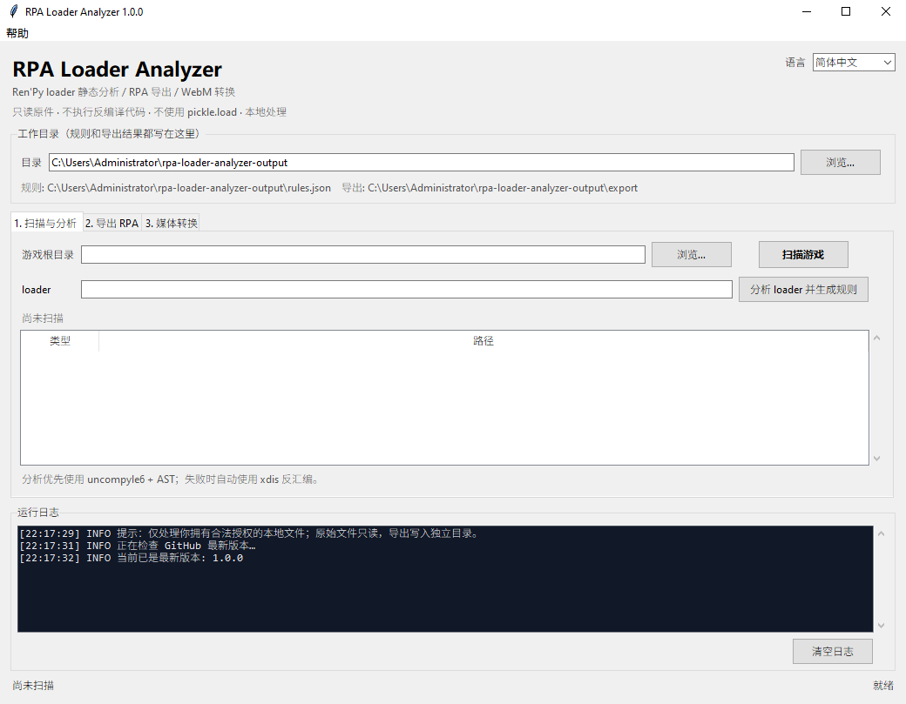

# RPA Loader Analyzer 1.0.0

**English** | [简体中文](README.zh-CN.md)

A local, read-only research toolkit for Ren'Py `loader.pyo` and RPA archives, with a
bilingual GUI, automatic update checking, and a Windows single-file executable.

[Full English README](README.en.md) · [完整中文说明](README.zh-CN.md)



## Highlights

- Static `loader.pyo` decompilation with uncompyle6, plus xdis disassembly fallback.
- AST-based XOR key extraction and normalized JSON rules.
- Safe RPA index parsing without `pickle.load`; XOR rule application and resource export.
- Simplified Chinese / English GUI with persisted language preference.
- **Help → About**: developer, build version, MIT License, repository, runtime.
- **Help → Check for Updates**: compares GitHub Releases/tags with the local version.
- WebM → MP4 pipeline based on `mp4_merger.py v4.5`: GPU encoder verification,
  NVENC/QSV/AMF/VAAPI support, automatic CPU fallback, CRF 16 / AAC 320k.
- Read-only originals, atomic output, path traversal protection, no recovered-code execution.

> For authorized files only. Do not use this project to bypass access controls, DRM,
> anti-cheat systems, or to redistribute game assets. See
> [docs/COMPLIANCE.md](docs/COMPLIANCE.md).

## Download

- [dist/RpaLoaderAnalyzer.exe](dist/RpaLoaderAnalyzer.exe) — Windows 10/11 x64
- Source: `main` branch; version `v1.0.0`

## Quick Start

```bash
python -m src scan "D:\Games\MyGame"
python -m src analyze "D:\Games\MyGame\renpy\loader.pyo" \
  --rules-out .\output\rules.json
python -m src export "D:\Games\MyGame\game\archive.rpa" \
  --game-root "D:\Games\MyGame" \
  --output "D:\Research\MyGame-export" \
  --rules .\output\rules.json
```

See the full language-specific README for installation, GUI usage, media conversion,
rule formats, security details, and build instructions.

## Documentation

- [Security model](docs/SECURITY.md)
- [Compliance and disclaimer](docs/COMPLIANCE.md)
- [RPA and rule formats](docs/FORMATS.md)
- [MIT License](LICENSE)

## License

MIT License. Copyright (c) 2026 dieraun.

The license covers this repository's source code and documentation only; it does not grant
rights to game content or cover third-party components.
